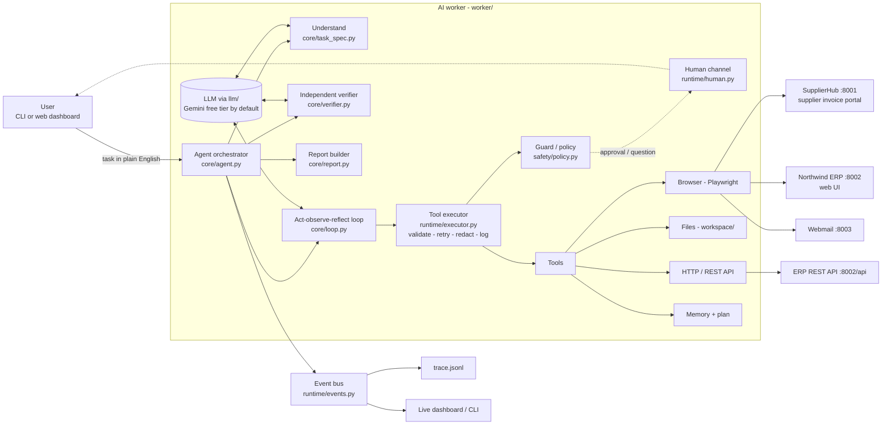
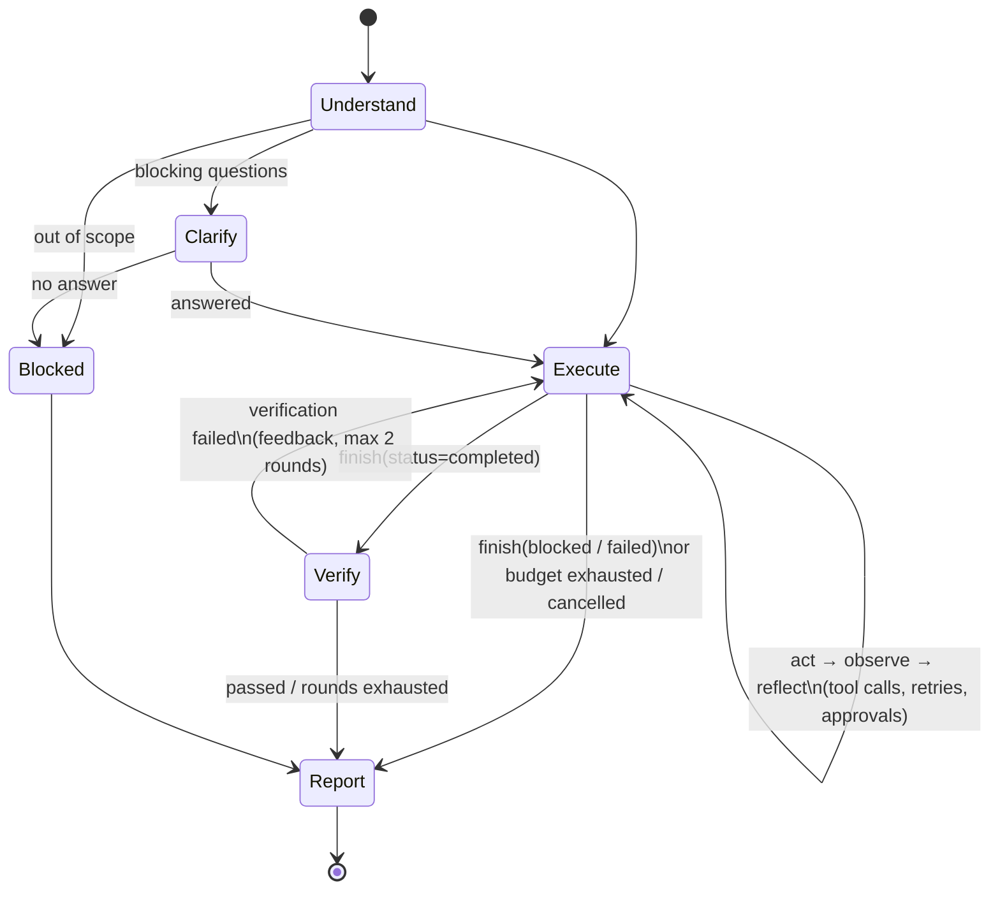

# Architecture

This document explains **what the parts are, how they fit together, and how one request flows
through the system**. For *why* it is built this way, see [DESIGN_DECISIONS.md](DESIGN_DECISIONS.md).
For a file-by-file tour, see [CODE_WALKTHROUGH.md](CODE_WALKTHROUGH.md).

---

## 1. The big picture

There are two halves:

1. **The AI worker** (`worker/`): takes a natural-language task and completes it by operating software.
2. **A simulated company** (`sandbox/`): three small web apps the worker operates. They stand in for the
   real systems an Accounts Payable clerk uses. They are deliberately realistic: logins, pagination,
   inconsistent formats, validation errors, duplicate checks and injectable failures.



## 2. The run lifecycle (state machine)

Every task goes through the same phases. The code for this is `Agent.run` in
[`worker/core/agent.py`](../worker/core/agent.py) and is meant to be read top to bottom.



| Phase | What happens | Output |
|---|---|---|
| **Understand** | One structured LLM call turns the request into a `TaskSpec`: end goal, deliverable, **objectively checkable success criteria**, whether data changes, risks, an initial plan, blocking questions, and an out-of-scope flag. | `TaskSpec` (pydantic) |
| **Clarify** | Only if the request lacks information the systems can't provide. Questions go to the human channel. | answers added to the kickoff |
| **Execute** | A tool-calling conversation. Each turn: the model picks tools → executor runs them (policy, retries) → results (with the **new page state**) go back. Loop and failure detectors add reflection notes. Ends when the model calls `finish`. | a *claim*: status, summary, evidence |
| **Verify** | (1) a deterministic rule check, then (2) a **fresh, read-only auditor agent** checks each success criterion against the live systems. On failure, the executor gets the findings and a chance to fix (bounded). | per-criterion verdict |
| **Report** | Final status computed from claim + verdict. `report.json`, `report.html`, screenshots, video and `trace.jsonl` written. | evidence bundle in `runs/<id>/` |

**Final status values:**
* `succeeded`: claimed completed **and** the verifier passed.
* `needs_review`: claimed completed but verification did not pass. The user should look.
* `blocked`: stopped safely and needs the user (approval declined, ambiguous, out of scope).
* `failed`: could not do it (including budget exhausted).
* `cancelled` / `error`: user cancelled, or provider/unexpected error. A report is still produced.

## 3. One request, end to end (the headline task)

> "Find the latest invoice from Acme, extract the amount and due date, enter it into our ERP, and tell me once it is done."

```mermaid
sequenceDiagram
    autonumber
    participant U as User
    participant A as Agent
    participant LLM as LLM (Gemini)
    participant X as Executor + Guard
    participant SH as SupplierHub
    participant ERP as ERP
    participant V as Verifier (fresh, read-only)

    U->>A: task
    A->>LLM: understand (structured output)
    LLM-->>A: TaskSpec (goal, success criteria, plan)
    A->>LLM: kickoff (task + spec + environment)
    loop act → observe
        LLM->>X: browser_navigate SupplierHub/login
        X->>SH: (policy: host allowed)
        SH-->>X: login page → snapshot text with [refs]
        X-->>LLM: snapshot
        LLM->>X: browser_type {{secret:...}} ×2, submit
        Note over X: vault fills real password,<br/>model never sees it
        LLM->>X: filter by ACME, sort by issue date, open INV-ACME-1102
        Note over LLM: default sort is "last updated";<br/>newest doc is a credit note → skip it
        LLM->>X: remember(total=4812.75, due=2026-11-01, source=...)
        LLM->>X: open ERP /bills/new, sign in, fill form (dates → YYYY-MM-DD)
        LLM->>X: click "Save bill"
        X->>X: Guard: form_submit, amount 4812.75 ≤ 10,000 → allowed
        X->>ERP: POST /bills/new
        ERP-->>X: "Bill B-1007 created" → snapshot
        X-->>LLM: snapshot + side effect recorded
    end
    LLM->>A: finish(completed, summary, evidence)
    A->>A: rule check: data-changing task has a recorded write ✓
    A->>V: success criteria + claim + facts + actions
    V->>ERP: search bills for INV-ACME-1102 (writes blocked)
    V-->>A: submit_verdict(passed, per-criterion evidence)
    A-->>U: report: SUCCEEDED, verified, B-1007, 4,812.75 USD due 2026-11-01 + screenshots
```

What changes for the other demo tasks (with **no code changes**):

* **Globex (18,250 USD):** when the agent submits, the Guard matches the `high_value_amount` rule and
  pauses for approval. "Reject" makes the tool fail with `rejected_by_user`, and the agent finishes `blocked`.
* **Initech:** two invoices issued the same day. The agent discovers this and calls `ask_user` with both options.
* **CHAOS=hard:** the ERP form returns 500. The executor does not auto-retry the POST (it is not
  idempotent). The agent checks that nothing was saved, reads the ERP API docs and creates the bill via `http_request`.
* **Inbox triage:** a different workflow over the same tools. Downloads PDFs, checks the ERP for duplicates,
  and ignores and reports the phishing email.

## 4. Components

### 4.1 LLM layer: `worker/llm/`
A provider-agnostic interface with two operations:
* `conversation(system, tools).send(tool_outcomes, notes, user_text) → AssistantTurn`, a multi-turn
  tool-using chat. Each provider keeps its **native transcript and only appends to it**.
* `structured(system, prompt, Schema) → Schema`, a one-shot call returning a validated pydantic object.

Implementations:
* `OpenAICompatClient` (`openai_compat.py`, default): one adapter for every OpenAI-compatible API, with presets for
  **Gemini (free tier, default)**, Groq, OpenRouter, Ollama and OpenAI. It includes a sliding-window rate limiter
  (requests/min and tokens/min) for free quotas, tool-schema sanitising for strict providers, JSON-mode structured
  output with one repair attempt, and preservation of provider extras on tool calls (e.g. Gemini thought signatures).
* `AnthropicClient` (`anthropic_client.py`): Claude (paid), with adaptive thinking and prompt caching.
* `ScriptedLLM` (`fake.py`): a deterministic fake for tests.

### 4.2 Tools: `worker/tools/`
Every capability is a `Tool` with a name, description, JSON schema, `is_idempotent(args)` and
`async run(args, ctx) → ToolResult`. A `ToolResult` carries the text for the model plus **structured
metadata**: `ok`, `error_kind` (an `ErrorKind` enum), `hint`, `screenshot`, `side_effect`, `retry_safe`.

| Group | Tools |
|---|---|
| Browser (Playwright) | `browser_navigate`, `browser_snapshot`, `browser_click`, `browser_type`, `browser_select`, `browser_extract_text`, `browser_back`, `browser_screenshot`, `browser_download` |
| Files (sandboxed to `workspace/`) | `file_list`, `file_read` (PDF text extraction), `file_write` (text or CSV rows) |
| APIs | `http_request` (allow-listed hosts, secret placeholders in headers/body) |
| Agent-internal | `remember`, `recall`, `update_plan`, `ask_user`, `finish` (+ `submit_verdict` for the verifier) |

**How the agent "sees" a web page:** `dom_snapshot.js` converts the DOM to compact text in reading order.
Headings become `#`, table rows become `| a | b |`, and every interactive element becomes an inline
token such as `[12:button "Save bill"]` (the element is tagged `data-agent-ref="12"` in the DOM).
Actions use the ref number. Every page-changing action returns the new snapshot automatically.

### 4.3 Runtime: `worker/runtime/`
* `executor.py`: runs one tool call: validate args → run → classify exceptions → **auto-retry only
  transient errors on idempotent calls** (exponential backoff) → redact secrets → emit events.
* `loop_detector.py`: watches (action, outcome) pairs and injects a *reflection note* on repeated
  identical calls or on streaks of failures.
* `human.py`: the `HumanChannel` protocol and its CLI, web and scripted implementations.
* `events.py`: the event bus and the JSONL trace writer.
* `context.py`: `RunContext`, everything a tool needs (browser, vault, guard, memory, plan, events...).

### 4.4 Safety: `worker/safety/`
* `policy.py`: the `Guard`. Tools describe side-effecting actions as `ProposedAction`s (navigate,
  form_submit with fields, http_write with body, click with label, file_write). The Guard enforces
  `config/policy.yaml`: host allow-list, blocked paths, read-only mode for the verifier, and **approval
  rules** (amount > 10,000, destructive verbs, HTTP DELETE). Approvals are remembered per action
  fingerprint.
* `secrets.py`: the vault. The model uses `{{secret:name}}` placeholders. Values are substituted only
  inside tools and redacted from everything that flows back.

### 4.5 Memory: `worker/memory/`
* `WorkingMemory`: explicit facts with provenance (`key, value, source, step, url, screenshot`).
* `Plan`: the agent's revisable checklist (shown live in the UI).

The conversation transcript itself is the short-term memory. Facts are the curated long-term memory
for the run: they feed the verifier and the report.

### 4.6 Interfaces
* **CLI** (`worker/cli.py`): `run`, `serve`, `sandbox`, `reset`, `eval`. It prints the live event stream and handles approvals in the terminal.
* **Dashboard** (`worker/server/`): FastAPI + WebSocket + a static page. Each run executes in its own
  thread with its own event loop. Events stream to the browser. Approvals and questions are answered with buttons.

### 4.7 Sandbox: `sandbox/`
| App | Port | Highlights |
|---|---|---|
| SupplierHub | 8001 | login, filter/sort/paginate, invoice detail, PDF download |
| Northwind ERP | 8002 | login, sessions, vendors, bills list/search, new-bill form with server-side validation and duplicate detection, **REST API** + docs page |
| Webmail | 8003 | inbox, messages, PDF attachments, a prompt-injection email |

`chaos.py` injects faults (`off`/`mild`/`hard`). `/__admin/*` endpoints reset state for tests and evals;
the agent's policy blocks them.

## 5. Data and artifacts

```
runs/<run_id>/
  trace.jsonl      every event (phase, LLM turn, tool call/result, retry, approval, verification...)
  report.json      final machine-readable report (status, verdicts, facts, actions, metrics)
  report.html      human-readable evidence report
  screens/*.png    screenshot after every browser action
  video/*.webm     full browser session recording
workspace/
  inbox/ downloads/ outbox/    the agent's file area (path-traversal guarded)
sandbox/state/
  erp.db, pdfs/, seed_manifest.json    sandbox data (recreated by `worker reset`)
```

## 6. Configuration surfaces

| File | Purpose | Changes when... |
|---|---|---|
| `.env` | provider, model, effort, rate limits, budgets, browser flags, API key | you switch provider or tune behaviour |
| `config/environment.yaml` | the "onboarding doc": systems, URLs, sign-in placeholders, company rules | you point the worker at a different company/system set |
| `config/policy.yaml` | hard guardrails: allowed hosts, approval rules | your risk appetite changes |
| `sandbox/test_credentials.json` | fake test credentials read by the vault | never in production (use a real secret store) |
| `evals/tasks.yaml` | evaluation tasks + expected outcomes | you add test scenarios |

## 7. Concurrency model

* The agent is `async`. Tool calls in one model turn run **sequentially**, in order. UI actions depend
  on the previous state, so parallel execution would be unsafe.
* The dashboard runs each agent in a **dedicated thread with its own asyncio loop**. Events cross into
  the server loop via `call_soon_threadsafe`. Human answers cross back via a `concurrent.futures.Future`.
* The sandbox apps run as three uvicorn servers in background threads, bound to both IPv4 and IPv6
  loopback (on Windows, `localhost` resolves to `::1` first. IPv4-only binding costs ~2 s per new
  connection).
